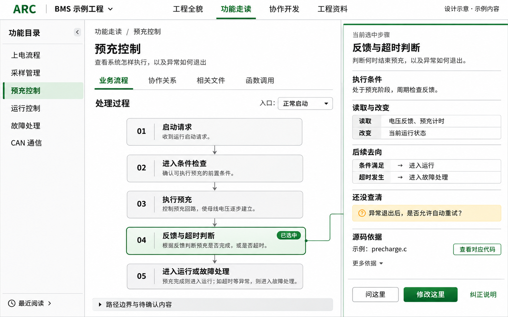
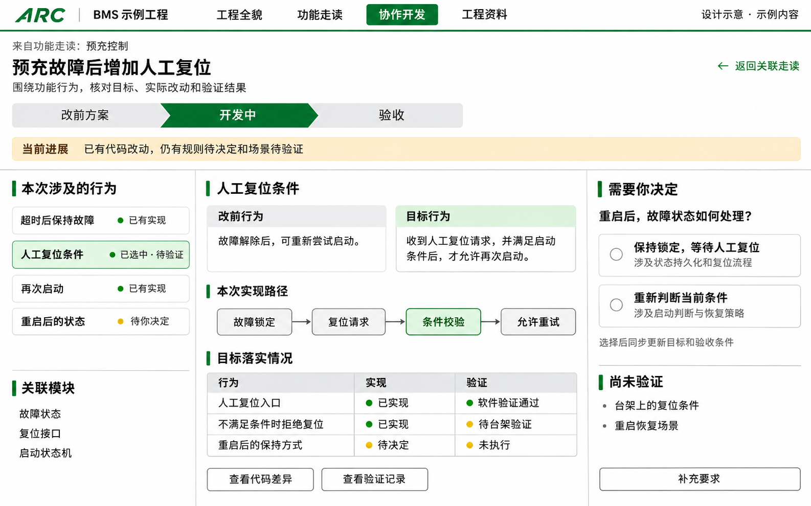

# ARC 功能走读右栏与协作开发界面交接

日期：2026-11-23。面向：Gemini、Codex 及负责集成验收的工程师。

本轮目标：调整功能走读右栏的信息与操作层级，并让同一项功能行为贯穿需求分析、开发和验收。工程师应能在 ARC 中看清现有行为、提出变化、处理关键取舍、核对实际结果与证据。

这是待实施的开发交接。下面的图片是设计示意，BMS 业务、文件名、实现状态和验证结果均为示例，不代表真实工程逻辑或本轮已经完成的功能。文字要求约束行为，图片用于理解布局；不得为了复现图片伪造源码关系、数据和通过状态。

## 1. 开发前先核对当前工程

仓库：https://github.com/whj1677/arc

本次源码分析基线：[58b4f302310dfa8005e3c53a8566204f51c729f3](https://github.com/whj1677/arc/commit/58b4f302310dfa8005e3c53a8566204f51c729f3)。本次仅核对了源码结构，没有对这一基线完成桌面运行验收。

执行前读取当前分支的 README、AGENTS.md 和相关代码，对照最新实现修正实施范围。若已有后续修改，保留并整合；不要把工作区重置回上述分析基线。

### 1.1 已有能力需要复用

| 已有能力 | 基线中的主要位置 | 本轮处理 |
| --- | --- | --- |
| 功能走读与对象选择 | `src/ui/FeatureReading.tsx`、`src/ui/CanvasPane.tsx` | 保留中心阅读能力与已有视图 |
| 右侧说明、提问、依据、进度、历史 | `src/ui/DetailPane.tsx` | 调整默认内容、入口位置和对象联动 |
| 右栏收起、固定、调宽、窄屏抽屉 | `src/ui/main.tsx`、`src/ui/DetailPane.tsx` | 复用，不能作为本轮新增成果 |
| 原位提问、引用、批注、阅读位置 | `src/ui/ReadingQuestions.tsx` 及现有阅读服务 | 保留上下文、持久化与历史关联 |
| 从功能发起修改 | `src/ui/FeatureDevelopment.tsx` | 复用来源绑定，改善入口位置与返回路径 |
| 需求输入、改前方案与待确认项 | `src/ui/RequirementComposer.tsx`、`src/ui/DevelopmentActivity.tsx`、`src/ui/DevelopmentHud.tsx` | 围绕同一项功能行为组织 |
| 架构和功能变化、源码差异 | `src/ui/EvolutionCockpit.tsx`、`src/main/evolution-view.ts` | 复用现有演化展示和真实差异 |
| 无任务的工作区变更监测 | `src/ui/LiveRadarView.tsx` | 保留外部开发后查看变化的入口 |
| 任务、验收条件、关联证据、版本与恢复 | `src/ui/EngineeringWorkspace.tsx`、`src/engineering.ts`、`src/delivery-audit.ts` 及现有服务 | 复用数据基础，把关键内容放到主视图 |

这些是源码中存在的结构和渲染逻辑，不等于所有交互已经实机验收通过。

### 1.2 当前值得调整的组织问题

1. 走读右栏同时承载解释、开发入口、证据、问答和运行管理，默认阅读重点不够集中。
2. 中心与右侧引用同一套步骤或文件数据，标题和概要容易重复；应检查实际页面后有针对性地精简。
3. 协作开发在输入、审阅、执行、交付阶段使用不同主组件，同一项行为的目标、实际变化和验证容易分散。
4. 基线的交付视图把详细“目标与验收”放入“更多原始记录、工作区基线与独立文档”，层级过深。
5. `EvolutionCockpit` 已有 `blueprintEvolution` 及改前/实际切换接口，但基线 `EngineeringWorkspace` 的交付调用未传该视图。实施时核对最新接线，按实际情况复用。

## 2. 两张界面示意图

### 2.1 功能走读与所选步骤详情

[打开图片原图](https://raw.githubusercontent.com/whj1677/arc/main/docs/design-assets/arc-walkthrough-inspector.png)

文字布局：左侧是功能目录；中间是当前功能的业务流程、协作关系、文件或函数视图；右侧随选中对象展示执行条件、数据与状态变化、后续去向、尚未查明的内容及源码依据。底部保留“问这里”“修改这里”“纠正说明”。

### 2.2 从走读进入协作开发

[打开图片原图](https://raw.githubusercontent.com/whj1677/arc/main/docs/design-assets/arc-collaborative-development.png)

文字布局：顶部保留任务目标、来源功能和阶段；左侧是本次涉及的功能行为；中间对照改前行为、目标、实际实现与验证；右侧放需要工程师决定的事项和当前缺口。返回走读时回到原功能及相关位置。

图片不是像素级锁定稿。延续现有 ARC 字体、色彩、组件与交互习惯，优先保证真实内容可读。状态颜色必须按事实映射：待验证、待决定、失败或过期不能使用“通过”的绿色表达。

## 3. 本轮产品边界

复杂开发是重点场景，工程掌控是用户获得的价值。界面以一次功能变更为主线：改前怎样、目标怎样、实际怎样、依据是什么。

本轮重点是现有能力的组织、呈现与必要的数据关联。保留工程全貌、功能目录、调用链、源码引用、问答、批注、阅读位置、历史、工程资料编辑、任务记录及迁移恢复。

保留当前可用的直连 Codex、DSH、外部会话和 MCP 等执行方式。接入方式以当前代码为准，不因早期方案或示意图没有画出设置入口而删除现有渠道。

不要求所有开发任务都从 ARC 发起。工程师在外部 Agent 或 IDE 修改后，仍能通过变更监测阅读实际变化，再关联目标或追加要求。

简单任务沿用轻量路径；复杂任务按需要展开影响、分歧和验收。不得新增每一步都要人工确认的流程，也不要求用户先填写完整 PRD 才能修改功能。

## 4. 功能走读右栏

### 4.1 三个区域的职责

| 区域 | 应解决的问题 | 主要内容 |
| --- | --- | --- |
| 左侧 | 我正在读哪个功能 | 现有功能目录、入口与阅读位置 |
| 中间 | 这个功能整体如何运行 | 流程、参与方与交接、相关文件、函数关系等已有视图 |
| 右侧 | 选中对象具体怎样起作用 | 条件、输入输出、状态或数据变化、异常去向、最直接的依据与操作 |

复用已有按选择展开、收起、固定、宽度调整和窄屏抽屉。未选中对象时遵循现有阅读布局，不放一大段重复的功能概述填充右侧。

右侧必须明确当前查看对象。未固定时随选择更新；固定时显示固定对象，提供清晰的解除固定操作。不同对象的内容不得混在同一详情中。

### 4.2 按对象类型组织内容

| 选中对象 | 默认优先内容 | 可展开内容 |
| --- | --- | --- |
| 处理步骤 | 执行或进入条件、关键判断、读取和改变的数据或状态、正常与异常去向 | 完整说明、相关文件与更多引用 |
| 函数或调用步骤 | 当前用途、参数与返回、关键分支、对外部状态的修改、调用位置 | 调用方/被调用方、完整函数源码 |
| 连线或交接 | 谁向谁传什么、触发时机、接收方如何使用、未明确的映射 | 参数对应、更多上下游依据 |
| 参与模块 | 在当前流程中的职责、接收什么、交付什么、关键接口 | 内部实现与关联文件 |
| 文件 | 在当前功能中的职责、相关实现入口、在哪些步骤用到 | 文件内容与其他入口引用 |

按实际已有数据和源码分析结果投影。信息未被识别时标记“尚未查明”，给出针对这一项追问或补查的入口；不得从相邻函数名或界面模板猜出业务条件、状态、副作用。

以当前对象为范围显示最直接的来源，点击后可查看正确版本、位置和源码。完整依据、长文件列表按需展开，避免默认占满右栏。

### 4.3 调整现有入口

| 现有内容 | 调整方式 |
| --- | --- |
| 说明 | 改为当前对象的结构化详情；精简与中心重复的概述 |
| 提问 | 就近提供“问这里”，沿用已有问答与历史，可切换对象/整个功能范围 |
| 依据 | 最直接引用紧邻对应说明；完整引用和源码按需打开 |
| 分析进度 | 放入页面级运行状态入口，保留查看事件、停止和恢复能力 |
| 历史 | 放入功能或分析结果的版本入口，保留版本比较与来源绑定 |
| 围绕这里修改 | 默认是明确按钮，点击后再展开输入；不让开发表单占据阅读说明顶部 |
| 补充线索与批注 | 在“纠正说明”或已有批注入口就近操作，保留持久化和原位置关联 |

“纠正说明”保存为用户补充或纠错线索，不能直接变成已证实的源码事实。普通追问保持现有只读语义，不自动重写工程图或业务代码。

### 4.4 从阅读进入修改

点击“修改这里”后，带上现有的项目、功能、场景、分析结果、来源快照、选中对象和必要源码引用。用户只需描述希望改变的行为及需要保持的约束。

复用现有任务和分析通道。打开任务后，来源功能可识别；返回走读时恢复相关位置。不要在切换页面、重新打开任务或历史版本时丢失来源关联。

## 5. 协作开发的稳定主视图

### 5.1 以功能行为贯穿各阶段

保留现有任务作为记录基础。把用户关心的具体行为对应到已有步骤、验收条件和相关功能，而不是让用户在每个阶段重新寻找自己的要求。

例如“人工复位条件”是一项可讨论、可实现、可验证的行为；“改动 8 个文件”是展开后可查看的工程依据。行为清单应从当前任务与分析结果形成，不能预置 BMS 示例条目到真实项目。

切换“改前方案”“开发中”“验收”时，保留当前选中的行为。各阶段重点不同，但目标、实际变化和证据的对应关系不变。

### 5.2 页面布局与内容

| 位置 | 内容与操作 |
| --- | --- |
| 顶部 | 任务目标、关联功能、真实阶段/状态、必要版本信息和返回走读 |
| 左侧 | 本次涉及的功能行为、各自状态、当前选择；复杂任务可按已有功能分组 |
| 中间 | 改前行为、目标行为、必须保持的约束、实际变化和逐项验证；关联架构、流程、源码差异按问题展开 |
| 右侧 | 有实际后果的待决事项、目标与实际的偏离、影响待核对及尚未验证项；每项都有对应操作 |

没有待决或待处理内容时收敛右侧，避免空面板占据主要空间。执行日志、完整文件列表、引擎诊断和原始记录保留为可访问详情。

改前分析尚未完成时展示已知目标及分析状态，不假装已知完整影响。执行中可以展示已捕获的代码变化，但不能将其等同于行为验证通过。

### 5.3 改前、目标与实际分别处理

| 内容 | 来源与约束 |
| --- | --- |
| 改前行为 | 绑定开始时的源码或分析基线；无法确认的部分保持未知 |
| 目标行为与约束 | 来自用户要求及已确定的选择，可修订并保留版本 |
| 计划实现 | Agent 的方案与预计影响，明确仍是计划 |
| 实际变化 | 已捕获的代码状态、差异及相应分析；保持来源和归属信息 |
| 验证依据 | 与当前行为、目标及代码版本相关的执行结果或人工核验记录 |

用户改变目标或方案时，不得随之改写实际变化与原始验证结果。要能显示“目标变了，已有实现不匹配”或“当前证据不足以支持新目标”。

对开始前已有改动、其他执行者产生的重叠修改及归属不明确的差异，沿用现有归属提示，不能把整个工作区的变化都算成本任务成果。

### 5.4 关键决定必须影响后续工作

每项重要取舍展示：问题、可行选项、各自影响、推荐理由（确有依据时）及允许补充的内容。选项应围绕业务行为、兼容约定、状态或接口等实质差异。

用户选择或修订后，应更新受影响的目标、方案、执行上下文和验收条件，保留选择依据和当前有效版本。后续 Agent 获取当前有效内容，而不是继续沿用旧需求包。

确实会改变行为的未决问题保持待决状态，不以“未填写”冒充已同意。低影响实现细节可以沿用合理默认并透明记录，无需新增逐步审批。

若任务正在执行，遵守现有任务版本和执行生命周期：明确哪些新要求尚未被本次执行读取，避免界面显示已经应用、执行器实际仍按旧目标运行。

### 5.5 验收进入主视图

按具体要求呈现实现与验证两个维度。至少区分：未开始、已有实现、已观测验证通过、失败、部分验证、未验证、待复验，以及 Agent 上报但未独立核验的声明。

每项验证能够追到现有证据记录、执行环境、所测代码状态和实际结果。构建成功不能自动使所有业务要求通过；源码引用或哈希校验不能自动使业务语义通过。

目标或相关代码发生变化后，只将受影响的证据判定为需要重新核对，不删除原始结果，也不无依据地使所有历史结果失效。优先复用现有 `criterion_id`、`evidence_ids`、代码状态和版本机制。

### 5.6 保留外部开发入口

未从 ARC 建立任务的工作区变化，仍可通过现有变更监测阅读、查看依据并发起后续要求。

没有关联目标时可以解释实际变化和潜在影响，但不能声称“符合需求”。用户补充目标或关联任务后，再建立目标、实际变化和证据的对应关系。

任务完成后，相关走读更新沿用原版本机制：已确认决定与有依据的变化回到功能认识中，旧版本可追溯；未更新或失效的说明明确提示。

## 6. 数据与实现约束

优先复用现有任务、步骤、验收条件、功能关联、工程资料与证据，不建立第二套与现有记录竞争的事实来源。先检查已有字段是否足够，通过 UI 投影或最小关联补充完成展示。

实施前，Gemini 和 Codex 对齐以下最小约定：

| 约定 | 必须明确的内容 |
| --- | --- |
| 行为标识 | 用现有标识或必要的稳定映射，使各阶段、页面和证据指向同一项行为 |
| 阅读上下文 | 选中对象类型、标识、功能/场景、结果与来源版本，固定/未固定状态 |
| 内容来源 | 区分源码支持、用户补充、Agent 推断、未查明和已过期内容 |
| 目标与决定版本 | 当前有效目标、关键决定、受影响行为、是否已交给当前执行 |
| 实际变化 | 代码基线、当前差异、归属、受影响功能及可能不确定的映射 |
| 验证关联 | 要求或条件标识、证据标识、所测代码/目标版本及状态 |

只补实现本轮交互确实缺少的字段与投影。数据无法可靠提供的内容，应使用明确空态与补查入口，不新增假计算、掌控度评分或无法解释的完成百分比。

共享类型、数据服务和 UI 的修改保持兼容。历史记录缺新字段时采用可解释的降级展示，不能破坏阅读数据、工程上下文和迁移恢复。

## 7. Gemini 与 Codex 建议分工

| 角色 | 主要责任 | 交付与协作方式 |
| --- | --- | --- |
| Gemini | 走读右栏与协作开发页面的信息结构、组件布局、响应式、选中态、空态及交互实现 | 在真实组件中落实两张图的组织方式，避免仅做静态页面 |
| Codex | 数据投影、目标/决定/证据关联、任务与来源版本、执行上下文及必要服务调整 | 复用现有类型与服务，提供真实数据和状态规则 |
| 集成负责人 | 共享文件整合、跨页面真实交互检查、回归与最终提交 | 明确指定一方；默认可由 Codex 承担，按实际环境调整 |

开始实现前，用一次简短协作约定确定共享数据字段、各自负责的文件和共同文件的修改顺序。`main.tsx`、`DetailPane.tsx`、`EngineeringWorkspace.tsx`、共享类型等容易发生重叠，安排一方主改或串行整合。

可以复用现有分支/worktree 工作方式，不强制新增复杂分支制度。不得覆盖对方或用户的未提交改动。接口变化及时通知另一方并更新同一任务记录，避免两套平行需求。

独立评审需要核对实际代码和运行证据，不能只复述另一方的完成说明。没有可用的直接 Agent 通信通道时，以同一任务、代码提交和本文件中的实施状态完成交接；不能声称已经建立了不存在的自动协作通道。

## 8. 建议实施顺序

1. **核对基线。** 阅读现有规则，确认已经完成的能力、待调整组件、共享数据和未提交改动。
2. **完成走读右栏。** 先实现对象类型对应的详情结构、就近依据和三个操作，保留阅读状态及来源。
3. **贯通协作开发主视图。** 保留任务和执行流程，让同一项行为在各阶段持续可见，接入真实差异和逐项验收。
4. **打通决定与证据状态。** 验证目标修订怎样影响执行上下文和验收，以及旧证据何时需要重新核对。
5. **完成真实链路检查。** 从走读提出修改、由现有执行器产生实际改动、核对结果，再返回关联功能。

阶段之间通过已有任务记录同步，不为每个阶段新增独立方案、报告或交付包。必要的实施状态可以直接更新本文件末尾。

## 9. 验收要求

| 编号 | 必须观察到的结果 |
| --- | --- |
| A1 对象切换 | 步骤、函数、连线、模块、文件分别显示匹配内容；未固定时随选择更新，固定时对象清晰且不混入新选择的数据 |
| A2 内容可信 | 条件、状态、副作用、异常路径均有明确来源或待查状态；不以示例填充真实项目；源码能跳到正确版本和位置 |
| A3 阅读操作 | “问这里”带正确上下文；“纠正说明”保留用户线索属性；普通追问不自动修改工程图或代码 |
| A4 阅读到开发 | “修改这里”带上正确功能、场景、对象和来源，任务入口清晰；返回后恢复关联走读和阅读位置 |
| A5 持续主视图 | 同一行为在改前、开发中、验收保持对应；方案、实际和证据可区分，切阶段不丢失当前选择 |
| A6 关键决定 | 改变一项有实质后果的规则后，目标、受影响方案、执行上下文和验收一致更新；正在执行的旧版本状态明确 |
| A7 识别偏离 | 选择与已有实际实现不同的目标时，明确显示不一致；不得为了显示通过而改写实际结果 |
| A8 证据与版本 | 代码已改、Agent 声明、已观测执行和行为验证分别显示；关键场景未运行保持未验证；受影响旧证据能被识别为待复核 |
| A9 外部入口 | 保留外部 Agent/IDE 修改后的变更查看；未关联目标不伪称符合需求；外部入口的任务能沿用相同记录与结果 |
| A10 布局 | 在现有桌面和窄屏布局下阅读真实长标题、长路径和多条结果，无覆盖、截断重要操作或无法阅读的多栏挤压 |
| A11 历史兼容 | 旧阅读记录、问答/批注、任务、工程资料和来源历史仍可访问；相关恢复能力未被本轮变更破坏 |
| A12 真实开发 | 使用当前可用的代表性执行通道完成真实工程改动和必要验证；ARC 发起及外部 Agent 接入两种入口分别给出实际结果或明确阻塞 |

### 9.1 检查范围与证据

按照当前 AGENTS.md 执行类型检查、构建和受影响测试；界面交互使用项目已有 Playwright/Electron 入口进行实际检查。针对本轮具体剩余风险补必要检查，不为简单布局变化增加镜像式单元测试或大量防御代码。

挑选一条真实的跨模块或跨状态需求，覆盖“选择对象 → 提出修改 → 关键决定 → 实际变化 → 证据核对 → 返回走读”。只读页面检查、静态图、mock 数据、任务回填成功都不能替代实际开发验收。

遇到已知环境阻塞，按仓库规则停止该环境中的重复启动尝试，保留具体步骤、错误和日志，并明确哪些检查未完成。在可用宿主环境通过原入口补跑；不能将阻塞或模拟结果记为通过。

最终说明至少包含：实际改动范围、已通过检查、真实操作链路、对应代码版本，以及尚未完成或受阻的部分。截图用于证明布局，日志和实际结果用于证明执行与验证；两者不能互相替代。

## 10. 实施状态

当前状态：交接说明与设计示意已准备，功能改动尚未由本次交接实施。

后续只维护这一份交接说明。必要时在此更新实际实现提交、已完成项、验证结果和未解决项。两张 PNG 是本说明的引用资产，不另行生成多份“最终版”文档或打包文件。

## 11. 源码阅读入口

以下链接固定到本次分析基线，用于核对上述现状；实际实施以工作分支最新代码为准。

- [README](https://github.com/whj1677/arc/blob/58b4f302310dfa8005e3c53a8566204f51c729f3/README.md)
- [AGENTS.md](https://github.com/whj1677/arc/blob/58b4f302310dfa8005e3c53a8566204f51c729f3/AGENTS.md)
- [DetailPane.tsx](https://github.com/whj1677/arc/blob/58b4f302310dfa8005e3c53a8566204f51c729f3/src/ui/DetailPane.tsx)
- [FeatureReading.tsx](https://github.com/whj1677/arc/blob/58b4f302310dfa8005e3c53a8566204f51c729f3/src/ui/FeatureReading.tsx)
- [ReadingQuestions.tsx](https://github.com/whj1677/arc/blob/58b4f302310dfa8005e3c53a8566204f51c729f3/src/ui/ReadingQuestions.tsx)
- [FeatureDevelopment.tsx](https://github.com/whj1677/arc/blob/58b4f302310dfa8005e3c53a8566204f51c729f3/src/ui/FeatureDevelopment.tsx)
- [main.tsx](https://github.com/whj1677/arc/blob/58b4f302310dfa8005e3c53a8566204f51c729f3/src/ui/main.tsx)
- [DevelopmentHud.tsx](https://github.com/whj1677/arc/blob/58b4f302310dfa8005e3c53a8566204f51c729f3/src/ui/DevelopmentHud.tsx)
- [EngineeringWorkspace.tsx](https://github.com/whj1677/arc/blob/58b4f302310dfa8005e3c53a8566204f51c729f3/src/ui/EngineeringWorkspace.tsx)
- [EvolutionCockpit.tsx](https://github.com/whj1677/arc/blob/58b4f302310dfa8005e3c53a8566204f51c729f3/src/ui/EvolutionCockpit.tsx)
- [LiveRadarView.tsx](https://github.com/whj1677/arc/blob/58b4f302310dfa8005e3c53a8566204f51c729f3/src/ui/LiveRadarView.tsx)

## 12. 给执行 Agent 的开始指令

请先完整阅读本说明和两张示意图，并核对当前分支的 README、AGENTS.md 及相关实现。围绕本文目标继续开发，复用已有能力、保留用户和另一执行者的修改。Gemini 主要落实界面与交互，Codex 主要落实数据、状态与集成；共享文件先约定归属和修改顺序。完成走读右栏及协作开发主视图调整，用真实操作和工程结果验证，明确未完成或受阻项，并按仓库规则提交和同步。示意图中的业务与验证数据不可用作真实验收证据。
